# HP-1: a handpan for the M-VAVE FM-1

HP-1 is custom firmware that turns the **M-VAVE FM-1**, a palm-sized FM synthesizer, into a
**handpan**. Each tone field is a physical model tuned the way the makers hammer them: a fundamental
with its octave and compound fifth ringing above it. The fields sit on a modeled 1.2 mm steel shell
with an air cavity inside, and you can slap, tap and thwap that shell from the keys.

**▶ Play it in your browser: <https://mcnasby.github.io/hp-1/>** (no FM-1 needed: the firmware's own
C code compiled to WebAssembly, with mouse, touch, computer keyboard and MIDI input).

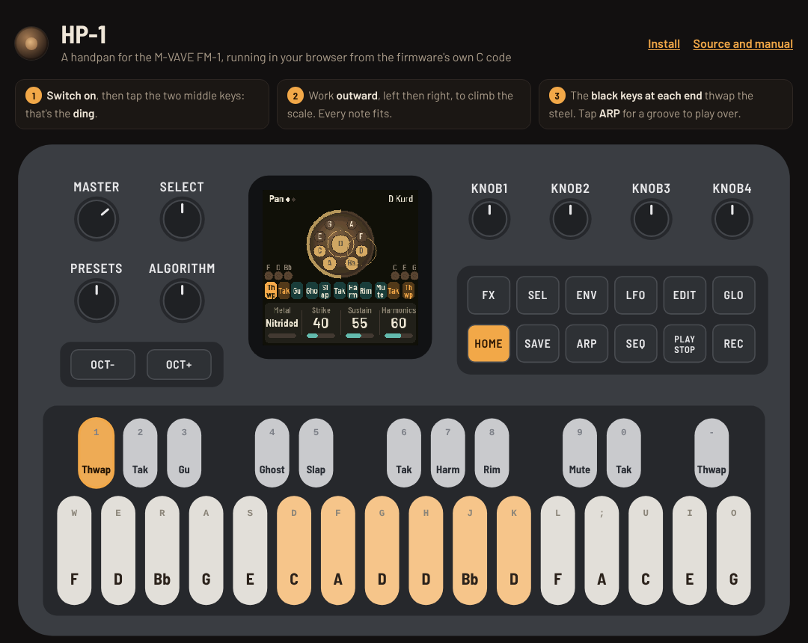

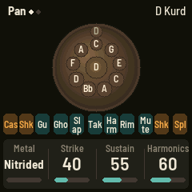 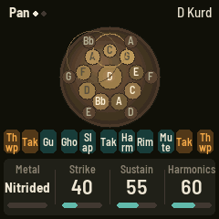 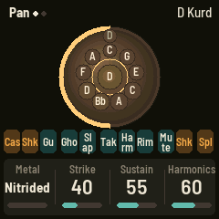 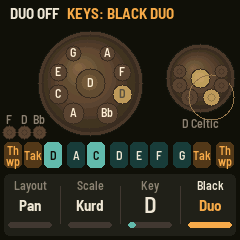

> **Status: beta.** HP-1 builds into a real FM-1 package, and every test passes: the engine, the
> whole app in a simulator, the browser build, and the installer against the package. It hasn't been
> played on an FM-1 yet. The platform underneath is FiMba-1's, which runs on hardware, and the
> package can't overwrite the chip's own update mode. Check the CPU load on the Setup page (GLO)
> after installing; see [Installing safely](#installing-safely).

---

## Contents

- [Pick it up and play](#pick-it-up-and-play)
- [The controls](#the-controls)
- [The scales](#the-scales)
- [How the handpan works](#how-the-handpan-works)
- [MIDI](#midi)
- [The browser version](#the-browser-version)
- [Building, testing, installing](#building-testing-installing)
- [Credits](#credits)
- [License](#license)

---

## Pick it up and play

1. **The middle two white keys are the ding**, the low note in the center of the pan. Either thumb
   finds it.
2. **Work outward to climb.** The tone fields alternate left, right, left, right, the way they zigzag
   up around a real handpan. Every key is in the scale, so nothing you play sounds wrong.
3. **The white keys at the ends are the steel.** The end keys are palm thwaps, the next ones in are
   fingertip taks, each on its own side of the shell. The black keys are a kit: castanets, shakers,
   the pan's own hits and a splash cymbal.
4. **Tap ARP** for a groove (ding, fields, taks and thwaps), and play over it.
5. **Turn ALGORITHM** to change the scale (it comes in the key makers usually build it in) and
   **PRESETS** to move it to any key. **SELECT** changes the metal.

The FM-1's keys only sense on and off, not how hard you press, so **Humanize** (ENV) gives each
strike a hand's natural variation in strength and brightness. Over MIDI, velocity does it for real.

## The controls

### The panel at a glance

```ascii
 ┌──────────────────────────────────────────────────────────────────────────────────┐
 │  MASTER   SELECT          ┌──────────┐    KNOB 1   KNOB 2   KNOB 3   KNOB 4      │
 │   (vol)   (metal)         │          │                                           │
 │                           │  screen  │    FX   SEL   ENV   LFO   EDIT  GLO       │
 │ PRESETS  ALGORITHM        │ 240×240  │   HOME  SAVE  ARP   SEQ   PLAY  REC       │
 │  (key)    (scale)         │          │                                           │
 │                           └──────────┘                                           │
 │   [OCT−]  [OCT+]                                                                 │
 │   ┌──────────────────────────────────────────────────────────────────────────┐   │
 │   │  black keys:  1 2 3   4 5   6 7 8   9 10   11                            │   │
 │   │  white keys:  1 2 3 4 5 6 7 8 9 10 11 12 13 14 15 16                     │   │
 │   └──────────────────────────────────────────────────────────────────────────┘   │
 └──────────────────────────────────────────────────────────────────────────────────┘
```

### White keys: the pan

**Layout** (SEL → Keys, KNOB 1) sets how the notes lie on the keys:

- **Pan** (the default): the ding on keys 8 and 9, the fields climbing outward in turn, the first on
  the right, as makers lay a pan out (a D Kurd's A3 on the right, Bb3 on the left, C4 right, D4 left
  ... C5 at the top).
- **Pan rev**: the same, left first, for those who play it the other way round.
- **Linear**: low to high, left to right, the ding on key 3.

The two keys at each end are always the steel: a palm **thwap** on the end key, a fingertip **tak**
on the next one in, each on its own side of the shell. In D Kurd (the default pan):

| White key | 1     | 2   | 3   | 4   | 5   | 6   | 7   | 8      | 9      | 10  | 11  | 12  | 13  | 14  | 15  | 16    |
| --------- | ----- | --- | --- | --- | --- | --- | --- | ------ | ------ | --- | --- | --- | --- | --- | --- | ----- |
| Pan       | Thwap | Tak | D5  | A4  | F4  | D4  | Bb3 | **D3** | **D3** | A3  | C4  | E4  | G4  | C5  | Tak | Thwap |
| Pan rev   | Thwap | Tak | C5  | G4  | E4  | C4  | A3  | **D3** | **D3** | Bb3 | D4  | F4  | A4  | D5  | Tak | Thwap |
| Linear    | Thwap | Tak | D3  | A3  | Bb3 | C4  | D4  | E4     | F4     | G4  | A4  | C5  | D5  | E5  | Tak | Thwap |

The pan's own notes are the ding and its 7 to 9 fields. The outer note keys carry the scale on up, as
the extra fields of an extended ("mutant") pan do. The screen shows every note the keys play on the
pan: the ding in the middle and every other note in one ring round it, evenly spaced, climbing in the
same zigzag from the player's side (the extra notes' labels a little quieter). The ding's keys glow dimly so you can
find the center without looking.

### Black keys: the kit, the second pan

The black keys follow **Black** (SEL → Keys, KNOB 4).

| Black key | 1         | 2      | 3  | 4     | 5         | 6   | 7        | 8   | 9    | 10     | 11     |
| --------- | --------- | ------ | ----- | ----- | --------- | ----- | -------- | ----- | ----- | ------ | ------ |
| **Kit**   | Castanets | Shaker | Gu    | Ghost | Ding slap | Tak   | Harmonic | Rim   | Mute  | Shaker | Splash |
| **Duo**   | Castanets | Pan 2  | Pan 2 | Pan 2 | Pan 2 | Pan 2 | Pan 2 | Pan 2 | Pan 2 | Pan 2 | Gu     |

- **Castanets:** two hardwood shells clacked.
- **Shaker:** an egg shaker: pushed on key 2 (left, swelling a little slower and longer), pulled back
  on key 10 (right, a quicker snap). Alternate them for a shuffle.
- **Splash:** a small cymbal slapped with a hand: a soft wash that blooms, its highs fading first.
- **Thwap** (white keys 1 and 16): a flat palm on the shoulder, the hard steel between the fields. The shell's own modes
  ring on that side, the air inside booms, and the nearby fields ring along.
- **Tak** (white keys 2 and 15, and black key 6 by the ding): fingertips on the steel: bright and short.
- **Gu:** a palm over the bottom port: the deep boom of the cavity.
- **Ghost:** a light fingertip between the fields.
- **Ding slap:** the ding struck and held, closed at once.
- **Harmonic:** a finger resting on the ding's center as it's struck: its octave and fifth sing, the
  fundamental doesn't.
- **Rim:** a knuckle on the rim seam.
- **Mute:** a palm over the top. Every field and the shell are damped.

**Duo:** the nine keys between the castanets and the Gu become a **second handpan** of nine notes
(its ding and eight fields, the scale going on up past a pan of fewer), in the same register as the
first: its ding sits where a pan in its key has it (an A pan's A2, a D pan's D3). It's laid out the
way the white keys are (Layout). In Pan, its ding is on the middle key (black key 6, F#4) and its
fields alternate outward, right then left; Pan rev goes left first; Linear runs low to high from the
left. Its ding's key glows dimly, as the first pan's do. Its scale and key are chosen to fit with the first pan: every
one of its notes is already in the first pan's scale (a pan with very few notes, such as Pygmy, may
add one, never a semitone off its ding). **Duo** (SEL → Duo, KNOB 1) steps through the matches, best
first: the same ding in another scale, then a fifth up, a fourth, the relative major or minor. It
starts on **Auto**, the best match, and goes back to it whenever you change the scale or key. For D
Kurd that's D Celtic.

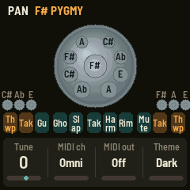 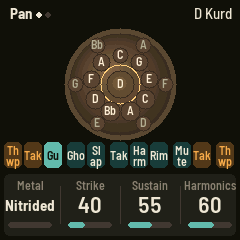

### Buttons

A button with more than one page shows the next one when pressed again. The dots by the page's name
show which page you're on.

| Button                            | Pages       | What it does                                                                                     |
| --------------------------------- | ----------- | ------------------------------------------------------------------------------------------------ |
| **HOME**                          | Pan → Shell | The metal and the strike; the shell's size and thickness                                         |
| **ENV**                           | Touch       | Wear, humanizing, tuning, release                                                                |
| **FX**                            | Space → Color | Reverb and delay; tape, lo-fi, chorus, filter                                                  |
| **LFO**                           | Grain → Spread | The grain cloud; its scatter, the echoes' feedback, the stereo width                          |
| **SEL**                           | Keys → Duo  | Layout, scale, key, black keys; the second pan, its level, the percussion level, the octave      |
| **SEQ**                           | Groove      | The groove's settings                                                                            |
| **GLO**                           | Setup       | Tuning, MIDI, the theme; the version and CPU load                                                |
| **EDIT**                          |             | Every page in turn                                                                               |
| **ARP**                           |             | **Tap:** the groove on and off. Lit while it runs, dark on each beat. **Hold:** the Groove page. |
| **PLAY**                          |             | Freeze the grain cloud; again to go live                                                         |
| **REC**                           |             | Palm mute                                                                                        |
| **OCT− / OCT+**                   |             | Move the pan an octave down or up                                                                |
| **SAVE**                          |             | Save now (settings also save themselves a few seconds after a change). Hold 1.5 s: reset.        |
| **OCT− + OCT+, held 5 s**         |             | Update mode (to install firmware)                                                                |
| **OCT− + OCT+, held at power-on** |             | Hardware calibration                                                                             |

### Encoders

| Control       | What it does                                                         |
| ------------- | -------------------------------------------------------------------- |
| **MASTER**    | Volume                                                               |
| **SELECT**    | Metal: Nitrided, Stainless, Ember, Raw                               |
| **ALGORITHM** | Scale, in the key it's usually built in                              |
| **PRESETS**   | Key: the ding's note                                                 |
| **KNOB 1–4**  | The current page's four values. Turning quickly moves in bigger steps. |

### The pages and their knobs

**HOME → Pan**

| Knob      | Range (default)                        | What it does                                                                                       |
| --------- | -------------------------------------- | -------------------------------------------------------------------------------------------------- |
| Metal     | Nitrided, Stainless, Ember, Raw (Nitrided) | The shell's steel and finish ([below](#the-metals))                                            |
| Strike    | 0–100 (40)                             | How the field is struck: 0 the soft pad of a finger (round, no skin noise), 100 a firm flick (bright, a burst of skin on steel) |
| Sustain   | 0–100 (55)                             | How long the fields ring, a quarter to four times the metal's own sustain                          |
| Harmonics | 0–100 (60)                             | How loud each field's octave, compound fifth and double octave are, against its fundamental        |

**HOME → Shell** (press HOME again)

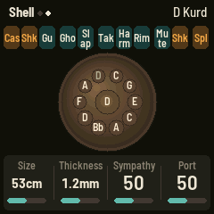

| Knob      | Range (default)     | What it does                                                                                                         |
| --------- | ------------------- | -------------------------------------------------------------------------------------------------------------------- |
| Size      | 44–62 cm (53)       | The pan's diameter. Bigger: a lower, rounder Gu and shell, and a slightly longer ring                                 |
| Thickness | 1.0–1.4 mm (1.2)    | The shell's steel. Thicker: a stiffer, brighter shell, a longer sustain, more steel in the strike                    |
| Sympathy  | 0–100 (50)          | How much the pan rings along: the fields whose partials a note meets, and the airy halo of harmonics it leaves ([below](#sympathy-and-the-air)) |
| Port      | 0–100 (50)          | The air inside: how much each strike, the Gu and the thwaps move the cavity                                          |

**ENV → Touch**

| Knob     | Range (default) | What it does                                                                                                       |
| -------- | --------------- | ------------------------------------------------------------------------------------------------------------------ |
| Worn     | 0–100 (0)       | A played-in pan: each field a little out of tune (up to ±10 cents), its octave a little off true, its own sustain, a wider shimmer |
| Humanize | 0–100 (35)      | Each strike's strength varies, as a hand's does; above 50, a hair of timing too                                    |
| Tuning   | Equal, Just     | Just: pure intervals over the ding                                                                                 |
| Release  | Ring, Damp      | Ring: a field keeps ringing after you let go, as on a real pan. Damp: letting go puts a hand on it                 |

**FX → Space**, **FX → Color**, **LFO → Grain**, **LFO → Spread** are FiMba-1's effects, unchanged:
reverb (amount, room), a ping-pong delay (level, time 40–740 ms, feedback), tape, lo-fi, chorus, a
one-knob filter (low-pass left, high-pass right), a granular cloud (level, grain length, density,
pitch, spray) and the stereo width. Every effect fades in and out without a click.

**SEL → Keys**: Layout, Scale, Key, Black (Kit, Duo).

**SEL → Duo** (press SEL again)

| Knob       | Range (default)     | What it does                                                      |
| ---------- | ------------------- | ----------------------------------------------------------------- |
| Duo        | the matches (Auto)  | Which second pan, best match first (Black on Duo)                 |
| Duo level  | 0–100 (80)          | The second pan's strength                                         |
| Percussion | 0–100 (70)          | The level of every hit on the steel                               |
| Octave     | −1–+1 (0)           | The same as OCT− / OCT+                                           |

**SEQ → Groove** (or hold ARP)

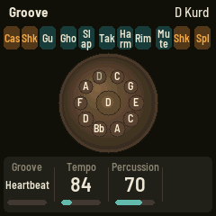

| Knob       | Range (default)                                   | What it does                                   |
| ---------- | ------------------------------------------------- | ---------------------------------------------- |
| Groove     | Heartbeat, Cascade, 3 over 2, Backbeat (Heartbeat) | Which groove ARP plays ([below](#grooves))     |
| Tempo      | 40–200 BPM (84)                                   | Three pulses a beat. MIDI clock takes over while it comes in. |
| Percussion | 0–100 (70)                                        | The same as on the Duo page                    |

**GLO → Setup**

| Knob     | Range (default)    | What it does                                                    |
| -------- | ------------------ | --------------------------------------------------------------- |
| Tune     | −50–+50 cents (0)  | Fine tuning, to play along with other instruments               |
| MIDI ch  | Omni, 1–16 (Omni)  | The channel MIDI is received on                                 |
| MIDI out | Off, On (Off)      | Send the keys as MIDI notes                                     |
| Theme    | Dark, Light (Dark) | The screen: a dim room with gold type, or sand and ink          |

The header shows the firmware version and the audio load (**CPU %**), and counts any dropouts.

**Reset to the defaults:** hold SAVE for 1.5 s, then press SAVE again. Any other button, or 5 s
of nothing, keeps everything. The Setup page is kept either way.

### The screen

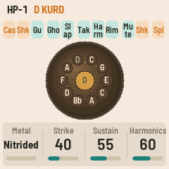 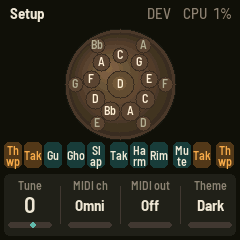

- **Header:** the page, its dots, tags (**FRZ** frozen grains, **GRV** a groove, bright on the beat,
  **DAMP**), and the pan: "D Kurd".
- **The pan from above**, shaded in its metal. Each field shows its note, glows as it rings, and
  sends a ripple out when struck. A thwap or tak lights the rim on that side; the Gu breathes in a
  ring round the ding. With Duo, the second pan stands to the right.
- **The black-key strip:** what each black key does now, above the pan, as the black keys sit above
  the white. The hand percussion (castanets, shakers, splash) is amber, the steel's kit teal, and
  each lights as it sounds. With Duo it shows only the two end keys (castanets, Gu): the second pan
  shows its own notes, and their place in the strip stays empty.
- **The knobs:** the page's four values. The one you turned is highlighted for a moment.

## The scales

From the scales most handpan makers offer. The steps are fixed, so the scale keeps its character in
any key: PRESETS moves the whole pan.

| Scale      | Usual key | Ding / tone fields                | Steps over the ding         | Character                                      |
| ---------- | --------- | --------------------------------- | --------------------------- | ---------------------------------------------- |
| Kurd       | D         | D3 / A Bb C D E F G A C           | 7 8 10 12 14 15 17 19 22    | The best known (Kurd 10): natural minor, warm, versatile |
| Celtic     | D         | D3 / A C D E F G A C              | 7 10 12 14 15 17 19 22      | Celtic minor (Amara): open, folky              |
| Integral   | D         | D3 / A Bb C D E F A               | 7 8 10 12 14 15 19          | Minor, meditative                              |
| Pygmy      | F#        | F#3 / G# A C# E F# G# A C#        | 2 3 7 10 12 14 15 19        | Pentatonic, earthy, hypnotic                   |
| Hijaz      | D         | D3 / A Bb C# D E F G A            | 7 8 11 12 14 15 17 19       | Harmonic minor, Middle Eastern                 |
| Aegean     | C         | C3 / E G B C E F# G B             | 4 7 11 12 16 18 19 23       | Lydian major, bright, floating                 |
| Equinox    | F         | F3 / Ab C Db Eb F G Ab C          | 3 7 8 10 12 14 15 19        | Dark, dreamy                                   |
| Akebono    | D         | D3 / A Bb D E F A Bb D            | 7 8 12 14 15 19 20 24       | Japanese pentatonic, spare                     |
| Major      | C         | C3 / G A B C D E F G              | 7 9 11 12 14 16 17 19       | Plain major, sunny                             |
| Mixolydian | G         | G3 / D E F G A B C D              | 7 9 10 12 14 16 17 19       | Major with a flat seventh                      |
| SaByeD     | E         | E3 / A B C# D# E F# G# B          | 5 7 9 11 12 14 16 19        | Colin Foulke's: major, its fourth below the octave, sweet and open |

The ding always sits between A2 and G#3, where the makers put it; OCT−/OCT+ move the whole pan.
Makers vary these lists a little from pan to pan.

## How the handpan works

### The tone fields

A handpan's tone field is a dimpled, hammered membrane in the steel, tuned so its first three modes
fall at **1 : 2 : 3**: the fundamental, the octave and the compound fifth (an octave and a fifth
up). That's why every note sounds like a small chord of itself, full and singing, where a kalimba's
tine has inharmonic overtones that give it a "ping."

HP-1 models each sounding field as a bank of resonators, set from measurements of real pans
(Eyal Alon, [*Analysis and Synthesis of the Handpan Sound*](https://etheses.whiterose.ac.uk/12260/), MSc by Research, University of York, 2015):

- **the fundamental**, steady. Measured pans ring about 3 s on average (0.9 to 5.9 s), low notes
  longer: here the D3 ding rings ~4–6 s, the high fields 2–3 s.
- **the octave**, nearly as loud as the fundamental, and often outlasting it;
- **the compound fifth**, 10 to 20 dB down;
- a twin of the octave and one of the fifth, a few hertz away. The pair pulses against each other at
  **3 to 9 Hz**, as measured: the field's two near-identical modes, and its neighbors a hair off
  tune. That pulse is the handpan's shimmer, and without it a field sounds like an electric piano's
  tine. Each field has its own rate, the same every time it's struck;
- **the double octave**, faint, about 20 dB down.

**The ding is a different kind of field.** It's the biggest, domed up rather than dimpled, sitting in
the middle over the port, and you strike it with a thumb or a palm. So it sounds big, full and round:
a soft, longer contact with little click or metallic ping, a fuller fundamental that rings about 30%
longer, the fifth and double octave tucked in, and it moves the air inside the most. Strike it again
while it rings and nothing stops it, so each strike adds to what's ringing and the ding builds the
more you play it (about 4 dB over four strikes). An ordinary field is stopped under the fingertip
first. The second pan's ding works the same way.

**The high fields are rougher**, as on a real pan. They're small and stiff, and the tuner can't
control them as tightly: in Alon's measurements and in recordings, from about F4 up the octave is as
loud as the fundamental or louder, the fifth is weaker, shorter and 5 to 25 cents off true, the
field's own untuned mode (about 2.5 times the note) comes in, and the neighboring fields ring along.
HP-1 does the same, growing from C4 to F5: a harder contact and a brighter skin burst, the octave up
and a little flat, the fifth down, shorter and off true, the stray mode, and the notes either side
ringing softly (with Sympathy). The low fields stay as clean as the tuner leaves them. How rough
depends on the metal: Stainless the most, then Raw, Nitrided, and Ember the least.

A strike is a force pulse with a short burst of skin on steel (the first ~10 ms of a real strike are
broadband): a soft finger pad is a long pulse (1.2 ms) with almost no burst, a firm flick a short one
(0.2 ms) with a brighter burst. The instant of contact also rings **the field's higher modes**, four
of them, untuned and inharmonic (5.2, 6.8, 8.6 and 11.3 times the note): the bright, metallic "tang"
at the front of every note, 10 to 20 dB under the fundamental, gone within a fifth of a second.
A firmer strike rings it more; it's an impulse, so even a soft finger pad keeps some of it. A firm strike also bends the field a few cents sharp for its first
moments, as a real one does. The ding is coupled to the air inside, which every strike pushes, so it
sounds faintly under every note (Sympathy). Sixteen fields can ring at once. A new note beyond that
takes over the quietest, which fades out instead of being cut. Re-striking a ringing field damps it
under the fingertip first, through its own decay, so it never clicks.

### The metals

| Metal     | The ding's ring (T60) | Shimmer   | Character                                                              |
| --------- | --------------------- | --------- | ---------------------------------------------------------------------- |
| Nitrided  | ~4.4 s                | ~4.5 Hz   | Carbon steel hardened in nitrogen: the classic dark pan, warm, strong octave |
| Stainless | ~5.7 s                | ~4 Hz     | Brighter, the longest ring; the fifth and the shell ring more          |
| Ember     | ~4.9 s                | ~3.6 Hz   | A softer nitrided alloy: mellow, the fifth tucked in, a gentle pulse   |
| Raw       | ~3.2 s                | ~6 Hz     | Plain cold-rolled steel (DC04): earthy, drier, a quicker pulse         |

Higher fields ring shorter than low ones, and rougher (above). Sustain, Size and Thickness scale it all.

### The shell and the air

Around the fields is the shell, modeled as **two banks of ten inharmonic modes**, one per shoulder,
whose lowest mode scales with the thickness and goes as one over the size squared, as a plate's
bending modes do. A thwap lands on one bank and you hear it on that side. Every strike brushes the
shell a little.

Inside is air, a **Helmholtz resonator** tuned by the bottom port: about 92 Hz on a 53 cm pan, lower
on a bigger one. Every strike pushes it (the ding most of all), the thwaps boom through it, and the
Gu is nothing but it. **Port** sets how much.

### Sympathy and the air

Strike D4 on a D Kurd and the D3 ding starts to ring with it, because D4 is the ding's octave. Its
compound fifth (A5) wakes the A4 field the same way. HP-1 checks every struck note's three partials
against every field's, and a field whose partial lands within 12 cents of one rings that partial
softly, a few milliseconds later. Sympathy only takes a free voice and never restrikes a ringing
field, so it can't steal a note you played. The thwaps wake the ding and the fields on their side the
same way. That's how the whole pan comes alive under your hands.

**The air** is the halo a real pan leaves hanging after each note. A resonator per note of the pan (the
ding and its fields), each tuned to that note, is fed the pan's sound and rings that note's whole
harmonic series (1, 2, 3, 4 ... its partials, which a handpan's are), darkening as it goes. Only what's
in the scale resonates, so the halo is always in tune. Two short diffusers a side spread it into the
room, each note's resonance on the side its field sits. It rings about 2.3 s at the default Sympathy
(none at 0, 3.4 s at 100), about 30 dB under the note. A palm mute (REC, or the kit's Mute) silences
it with the fields.

### The percussion

Each hit is a force pulse into the shell (on one side or both), a push on the air, and a burst of
noise for skin on steel, each shaped for what it imitates: a palm thwap is long, deep and wide, a tak
short and bright, the Gu nearly all air. The ding slap strikes the ding and lays a palm on it 30 ms
later; the harmonic strikes it with the fundamental damped.

The kit beside the pan has sounds of its own (no shell, no air), shaped against recordings (the
Versilian Community Sample Library). A cymbal has so many modes, so close together, that it rings as a
wash from 500 Hz up: the **splash** is noise in six octave bands, each with its own envelope. A palm
is soft, so nothing clicks: the wash blooms, the low bands in a few milliseconds and the top in about
30 (the energy climbing into the high modes), then the highs die first (~0.5 s) and the mids carry the
tail (~2 s), with a dull pat of the palm under it. The **shakers** are an egg shaker by Perry Cook's
PhISEM: the stroke's energy swells and fades, seeds hit the shell at random, and each hit is a tick of
noise through the shell's high ring (nearly all of it 6 to 16 kHz, a stroke lasting 0.15 to 0.3 s).
The **castanets** are a click into the shells' short ring. **Percussion** sets the level of them all.

### The signal path

```
 fields ──────────┐
 shell, air, skin ┴─► chorus ─┬──────────────────┬─► filter ─► tape / lo-fi ─► MASTER ─► out
                              ├─► grain cloud ───┤
                              ├─► delay ─────────┤
                              └─► plate reverb ──┘
```

### Grooves

ARP plays a groove over the pan: a cycle of 12 pulses, three to a beat. Each pulse plays the ding, a
field (counted up from the ding), or a hit on the steel. The first pulse is accented and no two
strikes are quite the same strength. The white keys play over it.

- **Heartbeat:** the ding on the beat, fields answering, taks and ghosts between.
- **Cascade:** down the fields into the ding, and back up.
- **3 over 2:** the ding and its fifth every three pulses against the fields every two.
- **Backbeat:** the ding and the Gu, thwaps on the backbeat, taks driving it.

## MIDI

MIDI comes in over USB and the TRS jack, on the Setup page's channel (Omni by default).

| Message                          | What it does                                                                     |
| -------------------------------- | -------------------------------------------------------------------------------- |
| Note on                          | Strikes the note of that pitch at that velocity (Tuning and Tune applied)        |
| Note off                         | Damps it when Release is Damp                                                    |
| Channel 10 notes (any MIDI ch)   | The steel and the kit: 35/36 Gu, 37 rim, 38/40 thwap left, 41/43 thwap right, 39 ding slap, 42/44 tak, 46 tak right, 49/55/57 splash, 53 harmonic, 51/59 ghost, 54 tak left, 69 shaker (pushed), 70 shaker (pulled), 85 castanets |
| CC 1 (mod wheel)                 | Sympathy                                                                         |
| CC 64 (sustain)                  | Holds damps back until the pedal lifts                                           |
| CC 72 / 73 / 74                  | Sustain / Strike / Harmonics                                                     |
| CC 91 / 93 / 94                  | Reverb / Grains / Delay                                                          |
| CC 120, CC 123                   | Damp everything                                                                  |
| Program change                   | Metal (0–3, wrapping)                                                            |
| Pitch bend                       | ±2 semitones, on every ringing note                                              |
| Clock, Start, Continue, Stop     | The groove follows the clock                                                     |

**Out** (off by default; Setup KNOB 3): the keys are sent as notes on the Setup channel.

## The browser version

**<https://mcnasby.github.io/hp-1/>**: the firmware's UI and sound engine compiled to WebAssembly,
running at the FM-1's 44.1 kHz in an AudioWorklet. Each key on the drawn FM-1 shows what it plays
right now (its note, or its hit), and the computer key that plays it.

- **Mouse and touch:** drag a knob up or down, or scroll over it. Click or touch keys and buttons;
  several fingers work on a touch screen. Shift-click (or right-click) a button to hold it down.
- **Computer keyboard:** <kbd>Space</kbd>, <kbd>G</kbd> or <kbd>H</kbd> for the ding; out along the
  home row (<kbd>F</kbd> <kbd>J</kbd> <kbd>D</kbd> <kbd>K</kbd> <kbd>S</kbd> <kbd>L</kbd> <kbd>A</kbd>
  <kbd>;</kbd>), then <kbd>R</kbd> <kbd>U</kbd>; tak <kbd>E</kbd> <kbd>I</kbd>, thwap <kbd>W</kbd>
  <kbd>O</kbd>. Black keys <kbd>1</kbd>–<kbd>0</kbd> and <kbd>-</kbd>. <kbd>B</kbd> groove, <kbd>Enter</kbd> mute,
  <kbd>`</kbd> freeze, <kbd>Esc</kbd> HOME, <kbd>Z</kbd>/<kbd>X</kbd> octave, <kbd>↑</kbd>/<kbd>↓</kbd>
  metal, <kbd>←</kbd>/<kbd>→</kbd> scale, <kbd>[</kbd>/<kbd>]</kbd> key.
- **MIDI:** "Connect MIDI" uses Web MIDI (Chrome or Edge).
- **Saving:** SAVE keeps your settings in that browser.

The same page installs HP-1 on an FM-1 (Chrome or Edge, Web MIDI with SysEx), with Felucca's update
protocol: connect the FM-1 by USB and press **Install HP-1 X.Y.Z**. It can also put M-VAVE's stock
firmware back.

## Building, testing, installing

The details are in [BUILDING.md](BUILDING.md). In short:

```
python3 -m venv .venv && .venv/bin/pip install -r requirements.txt && source .venv/bin/activate
tests/run_tests.sh                     # the engine, the platform pieces, the whole app in a simulator
./build.sh                             # build/hp1.fwsc (needs JieLi's toolchain and SDK files: BUILDING.md)
python3 tools/fm1_install.py --info    # check the installer finds your FM-1 (writes nothing)
python3 tools/fm1_install.py build/hp1.fwsc
```

- **The engine test** (`tests/host/handpan_test.c`, built without libm as on the device) checks the
  scales and layouts, every second-pan match against every pan in every key, each metal's pitch,
  octave and fifth, the shimmer (3–9 Hz) and the decays measured pans have, damping, sympathy, every hit (its side, the Gu's pitch against the
  size, the mute, the slap, the harmonic), the effects, that nothing clicks, the grooves and MIDI
  clock, and a 20-minute run. It writes one WAV per metal to `build/host/materials/`.
- **The host simulator** (`build/host/hp1_host SCRIPT OUTDIR`) runs the whole firmware from a
  script (`tests/scenarios/*.kal`). The screenshots in this README are its output.
- **GitHub Actions** tests everything, builds the firmware and the web app, and publishes the site.
  Merging a new `VERSION` with its `CHANGELOG.md` section to `main` makes a release.

### Installing safely

- **The recovery path can't be overwritten.** The update loader never writes the chip's own boot
  code and update mode.
- **A firmware that can't start falls back:** to safe mode after two failed starts (USB on, the
  installer works), to the chip's update mode after four.
- **The package can be checked:** `tools/check_fwsc.py` verifies every CRC and compares it region by
  region with FoMni's package. Everything but the app is byte-identical.
- **Have stock firmware ready.** Download M-VAVE's FM-1 V15 ("PC Firmware" at m-vave.com/download)
  first. `tools/fm1_rescue.py` or the web page puts it back.

## Credits

HP-1 is a fork of [FiMba-1](https://github.com/jadamsowers/fm1-fimba), a kalimba firmware for the
FM-1, and keeps its platform, effects, grain cloud, browser emulator and test harness. It replaces
the instrument: the tone fields, the shell and cavity, the percussion, sympathy, the handpan scales and
the second pan, the grooves, the screen, the pages and the tests.

| Who / what                                                                                         | What HP-1 uses                                                                              | License      |
| -------------------------------------------------------------------------------------------------- | ------------------------------------------------------------------------------------------- | ------------ |
| [FiMba-1](https://github.com/jadamsowers/fm1-fimba)                                                | The tree this started from: the modal voice, the effects, grains, delay, the UI frame, the browser page, the tests' harness | GPL-3.0-only |
| [Felucca](https://github.com/hugelton/Felucca), Leo Kuroshita (@kurogedelic), Hügelton Instruments | The platform: hardware layer, USB, storage, update loader, OTA, MIDI, LCD, drawing, build and install tools | GPL-3.0-only |
| [X0X](https://github.com/charlesvestal/fm1-x0x), Charles Vestal                                    | The platform adapted for another instrument, the host simulator                             | GPL-3.0-only |
| [FoMni](https://github.com/charlesvestal/fm1-fomni), Charles Vestal                                | Boot, safe mode, panel map, project storage, the UI's frame, the maths library, the plate reverb, the browser emulator | GPL-3.0-only |
| Jon Dattorro, "Effect Design, Part 1" (JAES, 1997)                                                 | The plate reverb's design                                                                   | —            |
| Barlow (The Barlow Project Authors), Terminus (Dimitar Toshkov Zhekov)                             | The screen's fonts                                                                          | SIL OFL 1.1  |
| JieLi AC79 SDK                                                                                     | Three small files placed in the package at build time (not in this repository)              | Apache-2.0   |

The details are in [LICENSING.md](LICENSING.md). The scale names are the handpan makers' own.
HP-1 isn't affiliated with or endorsed by M-VAVE, any handpan maker, or the authors above.

HP-1 was built in conversation with Claude (Anthropic's AI model) in Claude Code.

## License

GPL-3.0-only, the license of FiMba-1, Felucca, X0X and FoMni. See [LICENSE](LICENSE) and
[LICENSING.md](LICENSING.md). If you distribute HP-1 or firmware derived from it, you must give your
recipients its complete corresponding source under the same license.

M-VAVE and FM-1 are trademarks of their owners. HP-1 is independent firmware.
